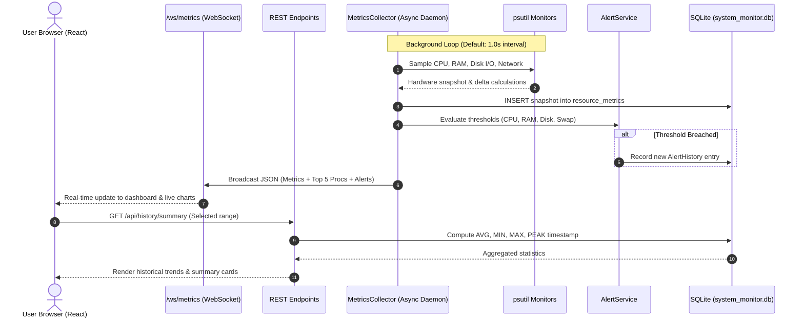
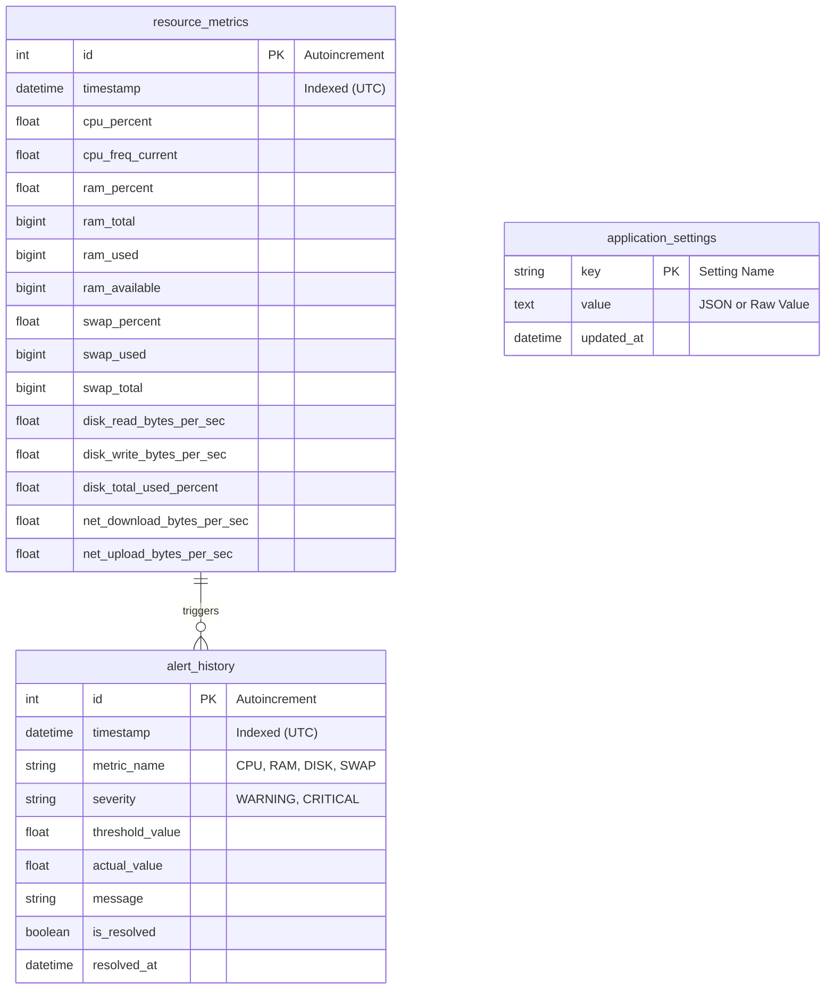

# System Resource Monitor
### Real-Time OS Performance Monitoring & Historical Telemetry Analytics
---

## 1. Project Overview & Introduction

The **System Resource Monitor (SRM)** is a full-stack, cross-platform system utility designed to observe, measure, log, and analyze low-level operating system resource allocation in real time. Built with an asynchronous Python backend (**FastAPI**, **SQLAlchemy**, **psutil**) and a high-performance modern frontend (**React 18**, **Vite**, **Tailwind CSS**, **Recharts**), SRM provides sub-second hardware telemetry without simulated or mocked metrics.

Every statistic presented—from multi-core CPU time slices and page faults to filesystem I/O bandwidth and network packet error counters—originates directly from kernel-level system counters exposed by the host operating system (Windows / Linux).

---

## 2. Problem Statement

Operating systems execute thousands of concurrent threads while balancing scarce physical resources (CPU cores, RAM frames, disk bandwidth, and network sockets). Modern operating systems incorporate complex scheduling and virtual memory management algorithms that operate largely invisibly to users and developers. Standard task managers frequently lack configurable data persistence, granular per-core frequency metrics, fine-grained I/O speed calculation, or historical statistical aggregation (min, avg, max, and peak timestamps).

**System Resource Monitor** bridges this gap by delivering:
1. Continuous sub-second kernel telemetry streaming over WebSockets.
2. Persistent historical logging in an embedded relational SQLite database.
3. Interactive visual performance analytics and custom timeframe aggregation.
4. An automated threshold-based health monitoring and alert engine.
5. In-depth process inspection and controlled, safe process lifecycle termination.

---

## 3. Operating Systems Concepts Demonstrated

> **Important Conceptual Note:** This application acts as an **observability and telemetry agent** that interfaces with OS kernel APIs; it does *not* replace the kernel scheduler, memory manager, or filesystem driver. Instead, it measures the operational efficiency of the OS kernel.

```
                      +---------------------------------------+
                      |         User Applications / GUI       |
                      +---------------------------------------+
                                          |
                      +---------------------------------------+
                      |    System Resource Monitor (SRM)      |
                      |  (FastAPI Backend + React Dashboard)  |
                      +---------------------------------------+
                                          |
                    ================== System Calls ==================
                                          |
    +-------------------------------------------------------------------+
    |                      Operating System Kernel                      |
    |  +--------------------+ +--------------------+ +---------------+  |
    |  | CPU Scheduler &    | | Virtual Memory &   | | VFS & Block   |  |
    |  | Dispatcher         | | Page Replacement   | | I/O Driver    |  |
    |  +--------------------+ +--------------------+ +---------------+  |
    +-------------------------------------------------------------------+
                                          |
    +-------------------------------------------------------------------+
    |                         Hardware Layer                            |
    |       [CPU Cores]          [RAM & Swap]         [Storage & NIC]   |
    +-------------------------------------------------------------------+
```

### A. Process Management & Task States
* **Process Control Block (PCB) Telemetry:** Captures process identification (PID), parent-child hierarchy, process execution state (`running`, `sleeping`, `stopped`, `zombie`), thread counts, and security credentials (user ownership).
* **Resident Set Size (RSS) vs. Virtual Memory Size (VMS):** Demonstrates the distinction between physical RAM actually held by a process (RSS) and the contiguous virtual address space reserved by the runtime (VMS).
* **Process Termination & Inter-Process Signals:** Implements controlled signal delivery (`SIGTERM` / `SIGKILL` or Windows `TerminateProcess`), requiring explicit safety verification while restricting termination of essential kernel processes (PID 0, 4 on Windows, PID 1 on Linux). Handles OS exceptions including `AccessDenied`, `NoSuchProcess`, and `ZombieProcess`.

### B. CPU Scheduling & Multi-Core Utilization
* **Time Slicing & Core Allocation:** Reads individual per-core processor times (`psutil.cpu_percent(percpu=True)`) to visualize Symmetric Multiprocessing (SMP) load distribution.
* **Frequency Scaling (P-States):** Tracks real-time CPU clock frequency (current, minimum, and maximum MHz) dynamically scaled by the OS power governor or hardware Turbo Boost.
* **Context Switching & Hardware Interrupts:** Monitors cumulative context switch rates (when the OS dispatcher switches the processor from one thread to another) and hardware interrupt requests (IRQ).
* **Load Averages:** Analyzes OS load averages over 1, 5, and 15-minute intervals, representing the exponential moving average of processes in runnable or uninterruptible states.

### C. Virtual Memory, Paging & Swapping
* **Physical RAM Allocation:** Breaks down memory into Used, Available, and Free frames.
* **Pagefile & Swap Saturation:** Evaluates secondary storage paging usage when memory demands exceed physical DRAM capacity.
* **Kernel Buffers and Page Caches:** Observes OS page caching where the kernel opportunistically holds frequently accessed filesystem blocks in unallocated RAM.

### D. Block Device Storage & I/O Subsystem
* **Filesystem Abstraction:** Discovers mounted disk partitions, storage devices, mount points, and filesystem types (`NTFS`, `ext4`, `FAT32`).
* **Instantaneous Rate Calculation:** Calculates instantaneous disk I/O throughput (MB/s) and IOPS by computing mathematical deltas between successive cumulative counter reads:
  $$\text{Throughput (Bytes/s)} = \frac{\Delta \text{Cumulative Bytes}}{\Delta \text{Elapsed Time (s)}}$$
* **Preventing Division by Zero:** Implements rigorous minimum time thresholds ($\Delta t \ge 0.001\text{ s}$) to prevent floating-point anomalies during rapid sampling.

### E. Network Stack & Socket Telemetry
* **Instantaneous Bandwidth Extraction:** Separately records cumulative octets received/transmitted versus instantaneous download/upload data rates.
* **Packet Reliability & Drop Counters:** Monitors hardware packet delivery errors (`errin`, `errout`) and kernel buffer overflow packet drops (`dropin`, `dropout`).
* **Interface Abstraction:** Displays IPv4 network bindings, MAC addresses, and full-duplex link speeds across virtual, Ethernet, and Wi-Fi adapters.

---

## 4. Technology Stack

| Layer | Component | Description |
| :--- | :--- | :--- |
| **Backend Framework** | Python 3.11+ / FastAPI | High-performance asynchronous REST API & WebSocket server |
| **Kernel Extraction** | `psutil` | Low-level OS hardware & process abstraction library |
| **Relational ORM** | SQLAlchemy 2.0+ | Object Relational Mapper for persistent metrics modeling |
| **Persistence Engine**| SQLite 3 | Embedded, lightweight zero-configuration ACID database |
| **Frontend Framework**| React 18 / Vite | Modern component-based single page application |
| **Styling & Theme**   | Tailwind CSS v4 | Windows 11 Task Manager & Grafana-inspired dark/light design system |
| **Data Visualization**| Recharts | SVG responsive real-time and historical charting |
| **Iconography**       | Lucide React | Clean, scalable system iconography |
| **Communication**     | WebSockets & REST | Sub-second real-time streaming + transactional REST routes |

---

## 5. System Architecture & Data Flow



---

## 6. Database Schema

The database file is stored automatically at `backend/data/system_monitor.db`.



---

## 7. REST & WebSocket API Specification

FastAPI automatically serves interactive OpenAPI documentation at `http://127.0.0.1:8000/docs`.

### System & Hardware Endpoints
* `GET /api/system/info`: Hostname, operating system, kernel release, uptime, total process count.
* `GET /api/cpu`: Overall %, per-core % array, core counts, current/min/max frequency, load averages.
* `GET /api/memory`: Total, used, available, free RAM, cached/buffered bytes, swap stats.
* `GET /api/disk`: Mounted partitions, total/used/free storage, current read/write MB/s.
* `GET /api/network`: Aggregated download/upload rates, total bytes, packets, per-interface cards.

### Process Management Endpoints
* `GET /api/processes`: Filterable list of running processes with `search`, `sort_by` (`cpu`, `memory`, `name`, `pid`), `order` (`asc`, `desc`), and `limit`.
* `GET /api/processes/top`: Returns top 5 CPU and top 5 Memory consuming processes.
* `GET /api/processes/{pid}`: Detailed process metadata (executable path, cmdline, creation timestamp, threads, handles).
* `POST /api/processes/{pid}/terminate`: Safe process termination requiring JSON body `{"confirm": true}`.

### Analytics & Maintenance Endpoints
* `GET /api/history`: Time-series query filtered by `start_time` and `end_time` (ISO 8601).
* `GET /api/history/summary`: Calculates statistical averages, minimums, maximums, and peak breach timestamps.
* `GET /api/history/export`: Streams downloadable CSV spreadsheet of all metrics in the specified range.
* `DELETE /api/history`: Clears metrics history table (requires `confirm=true`).
* `GET /api/alerts`: Lists recent alerts.
* `POST /api/alerts/{id}/resolve`: Resolves an active alert.
* `DELETE /api/alerts`: Clears alert history.
* `GET /api/settings`: Returns alert thresholds and collection parameters.
* `PUT /api/settings`: Updates thresholds and retention policies.

### Streaming WebSocket
* `WS /ws/metrics`: Sub-second duplex streaming endpoint broadcasting live telemetry frames.

---

## 8. Installation & Execution Guide

### Prerequisites
* **Python:** Version 3.11 or newer installed.
* **Node.js:** Version 18 or newer installed (Node v20+ recommended).
* **Git:** Installed.

### Step 1: Clone the Repository
```bash
git clone https://github.com/mihirkant21/System_Resource_Monitor.git
cd System_Resource_Monitor
```

### Step 2: One-Click Startup (Windows)
Double-click `run_all.bat` in the root folder, or execute from PowerShell:
```powershell
.\run_all.bat
```
This script launches both the FastAPI backend server and the Vite React frontend simultaneously in separate console windows.

---

### Step 3: Manual Execution (Alternative)

#### Backend Setup
```bash
# 1. Create and activate virtual environment
cd backend
python -m venv venv

# Windows:
venv\Scripts\activate
# Linux/macOS:
source venv/bin/activate

# 2. Install dependencies
pip install -r requirements.txt

# 3. Start the FastAPI server
set PYTHONPATH=backend
python -m uvicorn app.main:app --host 127.0.0.1 --port 8000 --reload
```

#### Frontend Setup
```bash
# In a separate terminal window:
cd frontend

# 1. Install npm packages
npm install

# 2. Launch Vite development server
npm run dev
```

Open your browser to:
* **Interactive Frontend Dashboard:** `http://localhost:5173`
* **FastAPI Swagger API Documentation:** `http://127.0.0.1:8000/docs`

---

## 9. Automated Testing Suite

The project includes an automated test suite verifying system monitors, database persistence, and API response contracts.

```bash
# Run tests using pytest
set PYTHONPATH=backend
backend\venv\Scripts\pytest backend\tests -v
```

### Test Coverage Highlights
* `test_monitors.py`: Validates psutil wrappers for CPU, RAM, Disk partitions, and Network interfaces with real system values.
* `test_repository.py`: Tests SQLite ORM models, record creation, summary queries (avg, min, max, peak timestamp), and retention cleanup.
* `test_api.py`: Validates all FastAPI endpoints (`/health`, `/api/system/info`, `/api/cpu`, `/api/memory`, `/api/disk`, `/api/network`, `/api/processes`, `/api/history`, `/api/settings`).

---

## 10. Dashboard Visual Interface

The dashboard incorporates a dark theme (inspired by Windows 11 Task Manager and modern infrastructure dashboards) with an optional light theme toggle:

1. **Overview Dashboard:** Four KPI summary cards with progress bars, four synchronized live area charts (CPU, RAM, Disk I/O, Network Bandwidth), and top 5 CPU & memory task lists.
2. **CPU Telemetry:** Dynamic circular utilization gauge, per-core utilization bars for each physical/logical core, current frequency scaling, and scheduler context switch counts.
3. **Memory & Paging:** Dual gauge meters for Physical RAM and Virtual Swap, distribution breakdown bars, and cached/buffered memory statistics.
4. **Disk Subsystem:** Formatted filesystem partition table (mount points, filesystem type, capacity, used/free space, and usage bars) with live read/write speed charts.
5. **Network Telemetry:** Live dual-series download/upload speed charts, total packets transferred, error/drop counters, and individual adapter cards (IP, MAC, link speed).
6. **Process Task Manager:** Searchable, sortable process table with live CPU and RSS memory consumption, full process inspection modal, and safety-verified termination.
7. **Historical Analytics:** Timeframe selector (Last 5m, 15m, 30m, 1h, 6h, 24h), statistical summary cards (Avg, Min, Max, Peak timestamp), and CSV export.
8. **Settings & Maintenance:** Interactive threshold sliders for CPU, RAM, Disk, and Swap alerts, sampling rate adjustments, and safe database maintenance tools.

---

## 11. System Limitations

1. **Operating System Permission Boundaries:** Certain protected kernel processes (such as Windows `System` or Linux `init`) intentionally withhold process executable paths and command-line arguments to maintain kernel security; SRM detects and flags these as `Access Denied` gracefully.
2. **Platform Counter Variations:** Specific memory counters (e.g. `cached` and `buffered` bytes) are reported natively on Linux kernels but may not be individually published by the Windows PDH subsystem. SRM detects the host operating system dynamically and displays graceful fallbacks without throwing runtime errors.
3. **Network Interface Link Speed:** Virtual loopback interfaces or certain Wi-Fi drivers do not report static link speeds (returning 0 Mbps); instantaneous bandwidth remains accurately calculated regardless.

---

## 12. Future Enhancements

* **Container Observability:** Extending the process table to identify Docker, Kubernetes, and WSL2 namespaces and container resource cgroups.
* **GPU Telemetry:** Integrating NVIDIA NVML / AMD ROCm monitoring for VRAM allocation, GPU core utilization, and temperatures.
* **Remote Host Telemetry:** Supporting an agent-server topology with authenticated gRPC metrics streaming from remote headless servers.
* **Email & Webhook Notifications:** Adding automated Slack, Discord, or SMTP webhook dispatches when persistent critical alerts are triggered.

---

## 13. License

This project is developed for academic evaluation purposes under the **MIT License**. Free and open-source software libraries are utilized throughout.

